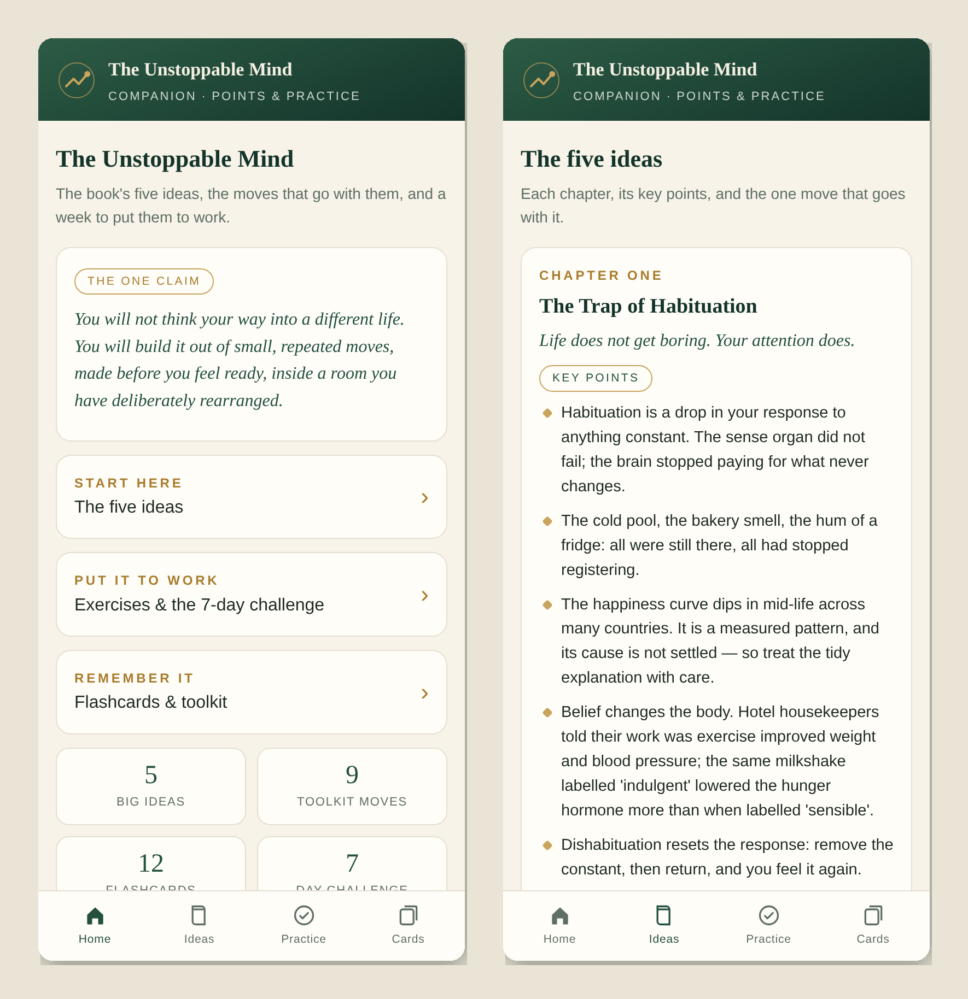

# The Unstoppable Mind — Companion App

**The book's key points and its exercises, in a form you can carry on your phone.**

**[Landing page](https://drsamonline.github.io/unstoppable-mind-companion/)** · **[Open the live app](https://drsamonline.github.io/unstoppable-mind-companion/play/)** · **[Repository](https://github.com/drsamonline/unstoppable-mind-companion)**

---

# The Unstoppable Mind — Companion App

A small, offline companion to the book **The Unstoppable Mind: Mastering Habituation, Confidence, and Power** by **Dr. Sohil Momin**.

It is not the book. It is the book's key points and its exercises, in a form you can carry on your phone.

> ### [Open the live app →](https://drsamonline.github.io/unstoppable-mind-companion/)
> No install, no sign-up. It runs in any browser.

---

## Contents

- [What's inside](#whats-inside)
- [Features](#features)
- [Use it](#use-it)
- [Files](#files)
- [Licence](#licence)
- [About the book](#about-the-book)

---

## What's inside

| | |
|---|---|
| **The five big ideas** | Each chapter with its key points, drawn from the book |
| **Your one move** | The exercise from every chapter, as a tickable task |
| **7-day challenge** | One small move a day to put the ideas to work |
| **12 flashcards** | The book's key terms, tap to flip |
| **Toolkit** | Nine practical moves — the five-second move, if-then plans, the three A's and more |

---

## Features

- **One file.** No build step, no dependencies, no framework.
- **Works offline.** Open it and it works; nothing is fetched.
- **No JavaScript needed.** Tabs, flashcards and checkboxes are pure HTML and CSS, so it works even where scripts are blocked.
- **Mobile-first.** Add it to your home screen and it opens full-screen.
- **Private by design.** Your ticks and notes are saved on your device only — no accounts, no tracking, nothing leaves your phone.

---

## Use it

**Live (recommended):** <https://drsamonline.github.io/unstoppable-mind-companion/>

**Offline:** download `index.html` and open it in any browser. That single file is the whole app.

---

## Files

| File | What it is |
|---|---|
| `index.html` | The whole app |
| `preview.png` | The preview image above |
| `badges/` | The badge images used at the top of this file |
| `LICENSE` | The free-to-use terms |
| `README.md` | This file |

---

## Licence

Copyright © 2026 **Dr. Sohil Momin**. **Free to use.**

You may use, copy and share this app freely, with attribution. Please do not sell it or claim you wrote it. See [`LICENSE`](LICENSE) for the exact terms.

---

## About the book

*The Unstoppable Mind* ties every claim to a named source. This app carries only the conclusions; for the arguments and the sources, read the book.

Made for readers of <em>The Unstoppable Mind</em>.

